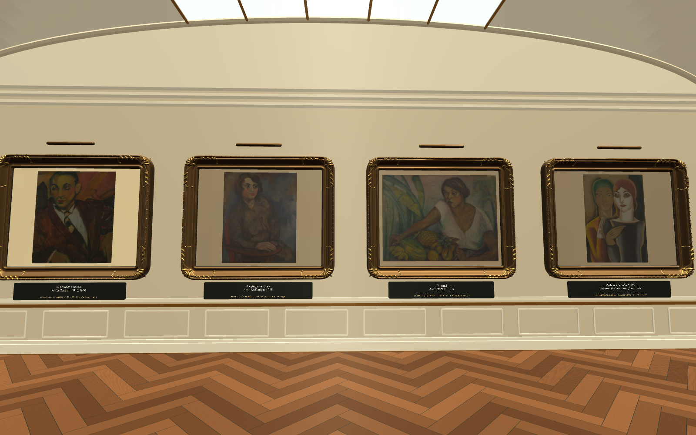

# Reproduções das obras na galeria

Etapa concluída em 16 de setembro de 2026. Nove composições demonstrativas foram
substituídas por reproduções verificadas, preservando as molduras e as proporções
visuais. As quatro faces das ilhas compartilham as mesmas imagens das respectivas
fichas. Os demais painéis históricos, esculturas e livros continuam cenográficos.

## Obras e fontes

| Obra | Autor | Data | Imagem de origem |
|---|---|---|---|
| [O homem amarelo](https://teses.usp.br/teses/disponiveis/43/43134/tde-06112015-143351/pt-br.php) | Anita Malfatti | 1915/1916 | 1261 × 1504 px |
| [A estudante russa](https://teses.usp.br/teses/disponiveis/43/43134/tde-06112015-143351/pt-br.php) | Anita Malfatti | c. 1915 | 1339 × 1667 px |
| [Tropical](https://teses.usp.br/teses/disponiveis/43/43134/tde-06112015-143351/pt-br.php) | Anita Malfatti | 1917 | 1546 × 1154 px |
| [Mulheres década de 20](https://masp.org.br/acervo/obra/mulheres-decada-de-20) | Emiliano Di Cavalcanti | Sem data | 4058 × 5816 px |
| [Menino nu e tartaruga](https://masp.org.br/acervo/obra/menino-nu-e-tartaruga) | Vicente do Rego Monteiro | 1923 | 3320 × 4280 px |
| [Retrato do desembargador Gabriel Gonçalves Gomide](https://masp.org.br/acervo/obra/retrato-do-desembargador-gabriel-goncalves-gomide) | John Graz | 1917 | 4516 × 3498 px |
| [Homens trabalhando](https://artsandculture.google.com/asset/homens-trabalhando-zina-aita/mwEUChwOAnkXEA) | Zina Aita | 1922 | 1200 × 855 px |
| [Eternos caminhantes](https://artsandculture.google.com/asset/eternos-caminhantes-lasar-segall/fAELR3B0k8NaOA) | Lasar Segall | 1919 | 1200 × 892 px |
| [Colombina](https://mam.org.br/wp-content/uploads/2022/04/mam-modernoondemodernoquando-catalogo-com-ad.pdf) | Ignácio da Costa Ferreira (Ferrignac) | Sem data | 330 × 748 px |

Proveniência completa, créditos fotográficos, hashes e preparo estão no
[manifesto das imagens](../UnityProject/Assets/Resources/MuseumArtworkImages.json).
Os perfis ICC de três arquivos foram convertidos para sRGB para compatibilidade
com a renderização. Nenhuma composição foi redesenhada, recortada ou ampliada
por IA. A foto de Zina Aita inclui sua moldura original. Colombina, de Ferrignac,
está limitada aos 330 × 748 px disponíveis na fonte; não equivale a uma imagem de alta resolução.

A estudante russa pertence ao IEB-USP. Homens trabalhando pertence a coleção
particular, com divulgação pelo MAM. Datas desconhecidas permanecem como “Sem data”.
A pintura de Vicente é de 1923; Segall continua identificado como contexto, sem
participação atribuída na Semana de 1922.

## Aplicação e verificações

- `ArtworkTextureSetup.Apply`: aplica o manifesto e preserva os alvos físicos do olhar.
- `ArtworkImageValidation.Run`: nove superfícies de parede e quatro faces das ilhas
  verificadas, incluindo UVs completos, orientação, proporção, créditos e importação.
- `LouvreValidation.Run`: 28 fichas, 96 cantos, acessos e circulação aprovados.
- `VrValidation.Run`: configuração e interação por olhar sem toque aprovadas no Editor.
- Cena: 336.822 triângulos, 436 renderers, 37 materiais e seis luzes sem sombras em tempo real.
- Importação das imagens: limite de 2048 px, mipmaps, sem cópia legível na CPU;
  override Android configurado para ASTC 6x6. Não foram medidos FPS ou memória em aparelho físico.

## Arquivos

- [APK atualizado](MuseumVR_Build/MuseudaSemanaArteModerna.apk): 96.041.147 bytes (96,0 MB), Android 8 ou superior, ARM64.
- [Verificação do APK](artwork-apk-verification.json): ZIP íntegro, assinatura v2 e plugin Cardboard presentes.
- [Blender atualizado](blender-preview/Museu_Com_Obras.blend): geometria completa, texturas empacotadas e câmera da galeria.
- [Versão anterior preservada](before-real-artworks/MuseuVR-before-real-artworks.apk).

SHA256 do APK: `b083996e0e830fa84b1c1272a0d40cde52cfb43e59395e65c27819f874689968`.

O APK instala o aplicativo Android. A edição do projeto continua no Unity/Blender.
