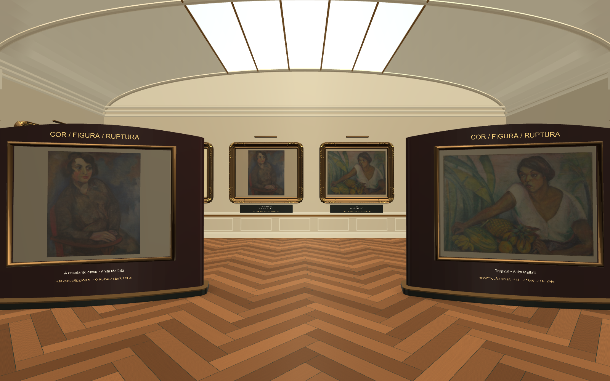
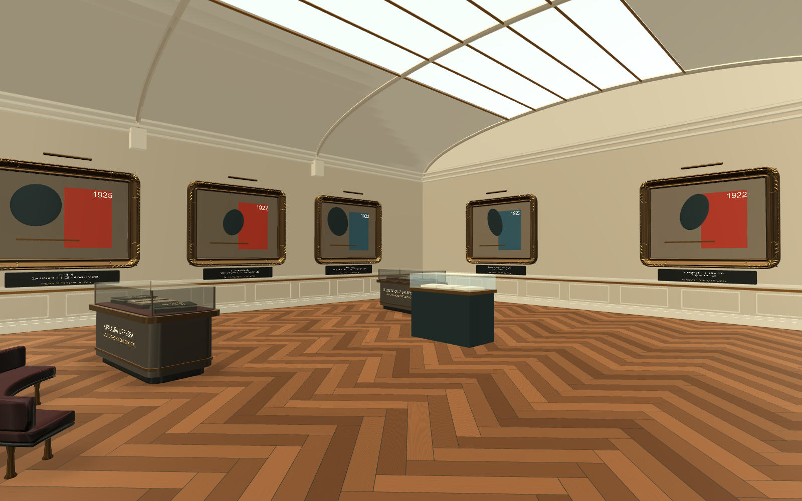
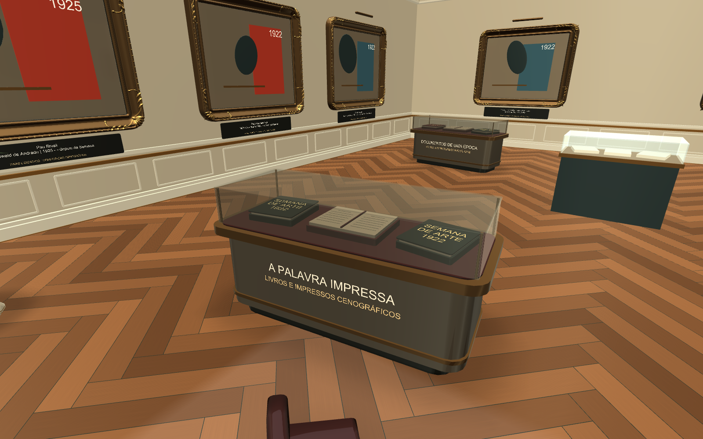

# Galerias com ilhas de exposição

O museu recebeu conjuntos de exposição no centro das salas e pontos de pausa para
dar profundidade ao percurso. As pinturas ampliadas e suas molduras de gala continuam
nas paredes; os novos elementos complementam a visita.

| Elemento | Quantidade e localização |
|---|---|
| Painéis curvos | Dois na galeria de pintura, com uma composição em cada face: quatro faces ao todo |
| Vitrines baixas | Quatro: duas no salão central e duas na galeria de literatura, com acabamento em pedra, bronze e vidro |
| Bancos curvos adicionais | Dois, nas galerias de escultura e literatura; seis bancos no conjunto do museu |
| Vasos com folhagem | Oito: quatro no salão, dois na pintura e um em cada galeria lateral |
| Sombras de contato | Sob 23 apoios: dois painéis, quatro vitrines, seis bancos, oito vasos e três pedestais |

Os livros, impressos e composições dos novos expositores são elementos cenográficos
e estão identificados dessa forma. Não representam documentos ou obras originais.

## Seleção pelo olhar e circulação

As quatro faces dos painéis e as quatro vitrines receberam `ExhibitGuideReference`.
Cada superfície encaminha a seleção pelo olhar à ficha existente correspondente,
mantendo o catálogo de 28 fichas. As faces apresentam estudos associados a
*O Homem Amarelo*, *A Estudante Russa*, *Pierrot* e *Tropical*; as quatro vitrines
usam a ficha documental existente.

As bases possuem colisores. Os caminhos principais permanecem abertos e foram
verificados na cena salva com a física do Unity.

| Verificação | Resultado |
|---|---|
| Exposições originais | 28 raycasts aprovados |
| Cantos das pinturas ampliadas | 96 raycasts aprovados, quatro por pintura |
| Novas superfícies interativas | Oito raycasts aprovados; a primeira superfície atingida abre sua ficha correspondente |
| Circulação nas galerias | Dez trechos aprovados, nas alturas de 0,55 e 1,70 m, com raio corporal de 0,30 m |
| Entradas das galerias | Quatro passagens aprovadas |
| Pisos | Seis posições de apoio verificadas |
| Controles VR | Configuração, seis cenários de dwell, leitura, páginas, fixação e saída aprovados no Editor |
| Sólidos e sombras | Bases com colisores ativos; sombras sem colisores |

Os textos dos expositores respeitam a profundidade da cena, evitando que legendas
apareçam através de paredes ou móveis.

## Geometria e iluminação

As sombras são malhas estáticas com intensidade suave, agrupadas em quatro salas.
Foram modeladas sob os apoios e salvas com a cena. Não são lightmaps resultantes de
bake nem sombras calculadas por luzes em tempo real. Ao mover os móveis, reaplique
o setup para atualizar essas marcas no chão.

A vegetação usa cinco malhas compartilhadas entre os oito vasos, dois materiais
verdes opacos e 6.768 triângulos no conjunto. As folhas têm duas faces e uma dobra
central, sem transparência ou animação. Os demais móveis são agrupados por material
em cada conjunto, permitindo ocultação por sala e por expositor.

A validação da cena aplica um limite de 350.000 triângulos. As contagens completas,
incluindo os submeshes efetivamente usados após static batching, ficam em
[louvre-geometry-metrics.json](louvre-geometry-metrics.json).

| Medida da cena ativa | Resultado aprovado |
|---|---:|
| Triângulos renderizados | 347.092 |
| Renderers ativos | 475 |
| Materiais únicos | 28 |
| Luzes ativas | 6 |
| Luzes com sombras em tempo real | 0 |
| Sombras de contato modeladas | 23 apoios, 2.960 triângulos em quatro malhas |

Essas contagens descrevem a geometria. Desempenho, aquecimento e conforto no visor
VR Box ainda precisam ser medidos no celular físico.

## Capturas da cena real

Renders mono do Unity em 1600 × 1000, com MSAA 4x para inspeção visual. O aplicativo
usa MSAA 2x; as capturas não são medições de desempenho no celular.

## Aplicação e manutenção

- Cena: `UnityProject/Assets/Scenes/MuseumScene.unity`.
- Menu do Unity: **Museum > Visual > Preencher ambiente com ilhas de exposição**.
- Rotina de aplicação: `MuseumModerna.LouvreAtmosphereSetup.Apply`.
- Grupo gerado: `Museum_LouvreStyle/Ambiente_Preenchido`.
- Fontes: `LouvreAtmosphereSetup.cs`, `LouvreGardenDetails.cs` e `LouvreContactShadows.cs`, em `UnityProject/Assets/Editor`.
- Referência de interação: `UnityProject/Assets/Scripts/Museum/ExhibitGuideReference.cs`.
- Malhas e materiais: `UnityProject/Assets/MuseumStyle`.
- Teste integrado: `MuseumModerna.LouvreValidation.Run`, que executa `LouvreRuntimeValidation` e gera as capturas.

O setup substitui seu grupo anterior, reutiliza os assets e preserva seus GUIDs.
As fichas históricas e os expositores originais permanecem associados ao mesmo catálogo.

[Registro dos testes executados](environment-validation.log).

## APK atualizado

[Instalador Android](MuseumVR_Build/MuseudaSemanaArteModerna.apk), gerado e verificado em
11 de setembro de 2026: 36.390.476 bytes (36,4 MB), ARM64, Android 8 ou superior.
Integridade ZIP e assinatura v2 aprovadas. Biblioteca Cardboard, referências de fichas e
objetos do ambiente confirmados dentro do pacote.

[Registro da verificação](louvre-apk-verification.json). O APK anterior está em
`before-environment-upgrade/MuseuVR-before-environment-upgrade.apk`.
