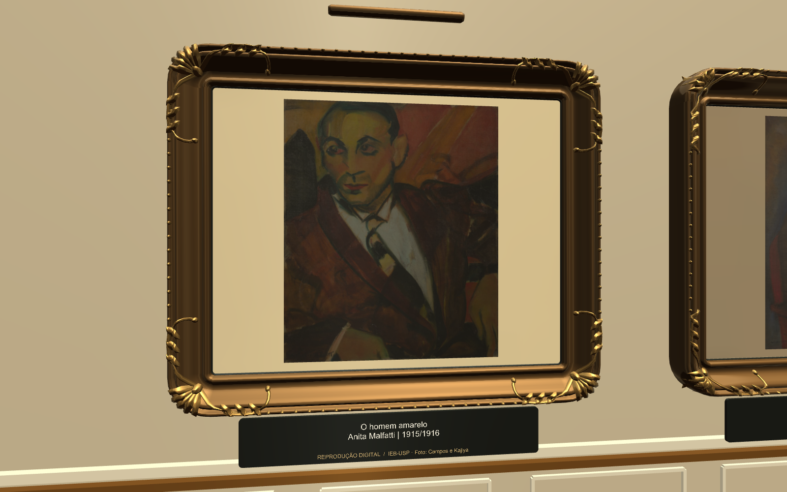
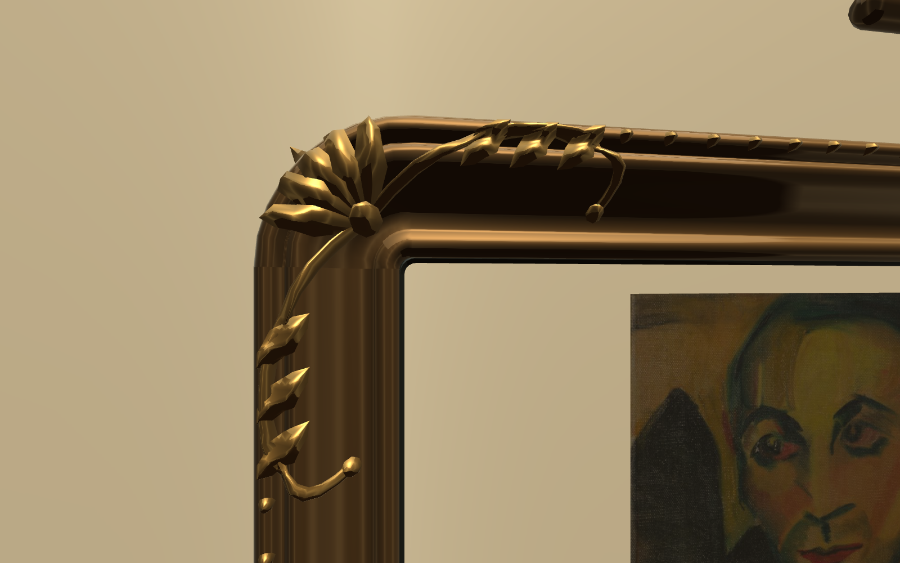
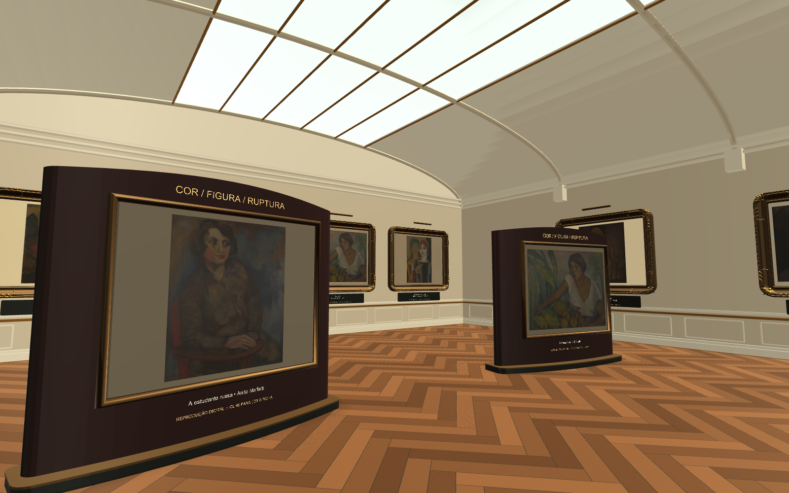

# Pinturas ampliadas e molduras de gala

Os 24 quadros e painéis receberam mais destaque em todas as galerias. A cena mantém
as 28 fichas, os controles pelo olhar e o percurso do museu.

| Elemento | Alteração |
|---|---|
| Tela | De 1,40 × 1,10 m para 2,38 × 1,87 m: 70% maior em cada dimensão e 2,89 vezes a área |
| Instalação | Centro a 2,55 m do piso; composição cenográfica ampliada junto da tela |
| Moldura | Perfil mais largo, com caveto, filetes e volumes de madeira entalhada |
| Acabamento | Ouro patinado na estrutura e ouro brunido nos relevos |
| Ornamentos | Palmetas, volutas, folhas e pérolas; relevos ajustados à superfície do perfil |
| Cartela e luminária | Reposicionadas para acompanhar a nova escala |

As composições continuam identificadas como cenográficas e didáticas. Os títulos,
autores, datas e relações históricas das fichas foram preservados.

## Capturas da cena real

Renders mono do Unity em 1600 × 1000, com MSAA 4x, usados para inspeção visual.
O aplicativo usa MSAA 2x. As imagens não representam uma medição no visor físico.

As capturas anteriores foram preservadas em `before-painting-upgrade`:

- [Moldura anterior](before-painting-upgrade/louvre-frame-detail.png)
- [Galeria anterior](before-painting-upgrade/louvre-painting-gallery.png)

## Validação da cena

Os testes em Play Mode foram aprovados novamente após o ajuste dos relevos à superfície
da moldura. A verificação utiliza a cena salva e a física real do Unity.

| Verificação | Resultado |
|---|---|
| Fichas e seleção central | 28 raycasts aprovados |
| Telas ampliadas | 24 telas verificadas, com molduras alinhadas |
| Área de interação ampliada | 96 raycasts aprovados, quatro por tela, próximos dos cantos |
| Separação entre molduras na mesma parede | 20 pares verificados; menor folga de 0,516 m |
| Circulação | Quatro passagens verificadas com raio corporal de 0,25 m; seis posições com piso sólido |
| Esculturas preservadas | Seleção das superfícies superiores reais das três esculturas aprovada |
| Geometria | Vértices e limites dos meshes ativos sem valores inválidos |
| Câmera | Uma câmera ativa |
| Controles VR | Configuração, seis cenários de dwell e integração sem toque aprovados |

### Custo de geometria desta etapa (antes das ilhas)

| Medida da cena ativa | Valor |
|---|---:|
| Renderers ativos | 343 |
| Triângulos renderizados | 316.620 |
| Materiais únicos | 24 |
| Luzes ativas | 6 |
| Luzes com sombras em tempo real | 0 |

Cada moldura utiliza até três materiais. As 24 molduras compartilham o mesh dos ornamentos;
os demais elementos são agrupados por material em cada quadro. Nenhuma luz adicional foi
necessária. A contagem de triângulos considera somente os submeshes atribuídos a cada
renderer, inclusive o deslocamento de static batching.

Essas medidas descrevem a geometria, sem afirmar FPS ou tempo de GPU. Desempenho,
aquecimento e conforto no VR Box ainda dependem de teste no celular.

A medição acima corresponde à etapa de ampliação das molduras. O preenchimento posterior
está registrado em [Galerias com ilhas de exposição](ENVIRONMENT_UPGRADE.md), com as métricas
atuais em [louvre-geometry-metrics.json](louvre-geometry-metrics.json).

## Aplicação e manutenção

- Cena: `UnityProject/Assets/Scenes/MuseumScene.unity`.
- Aplicar no Unity: **Museum > Visual > Destacar pinturas e aplicar molduras de gala**.
- O setup usa dimensões absolutas e pode ser reaplicado sem acumular aumento de escala.
- Fontes: `UnityProject/Assets/Editor/LouvreExhibitionDetails.cs` e
  `UnityProject/Assets/Editor/LouvreOrnateFrame.cs`.
- Meshes e materiais persistem em `UnityProject/Assets/MuseumStyle`.
- Validar: `MuseumModerna.LouvreValidation.Run` em Unity batch mode, sem `-quit`.

Este registro documenta a cena e suas capturas. A verificação do instalador Android é
mantida separadamente em [louvre-apk-verification.json](louvre-apk-verification.json).

## APK desta etapa

[Instalador desta etapa](before-environment-upgrade/MuseuVR-before-environment-upgrade.apk), gerado e verificado em
10 de setembro de 2026: 35.627.514 bytes (35,6 MB), ARM64, Android 8 ou superior.
Integridade ZIP, assinatura v2, biblioteca Cardboard e objetos das molduras no pacote confirmados.
O APK anterior foi preservado em `before-painting-upgrade/MuseuVR-before-painting-upgrade.apk`.

[Registro dos testes executados](painting-validation.log).
